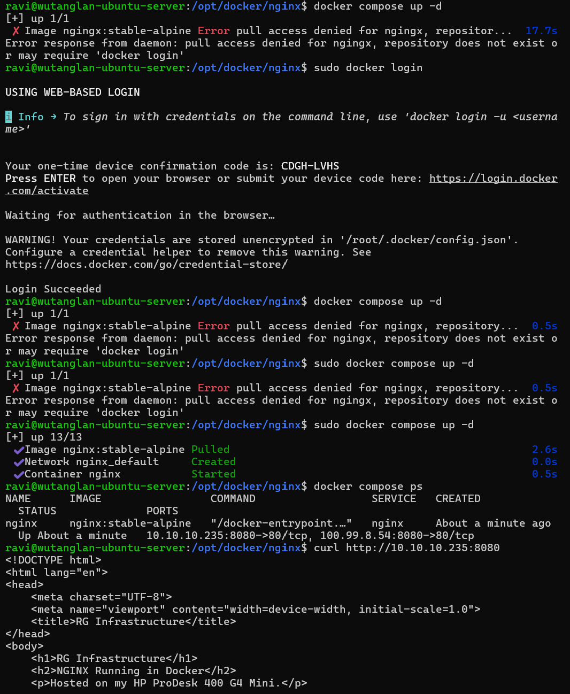
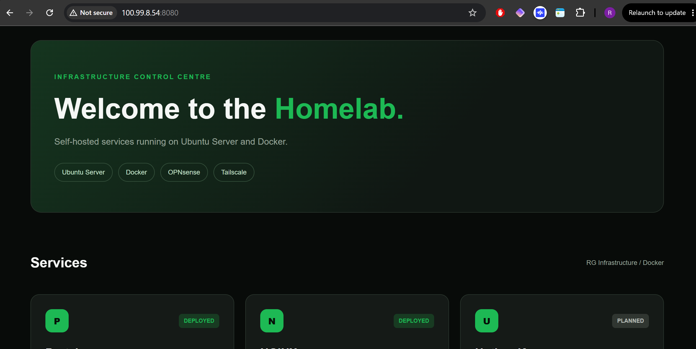

# Lab 03 — Deploying NGINX with Docker Compose

## Overview

This lab documents the deployment of an NGINX web server on my HP ProDesk 400 G4 Mini using Docker Compose.

The objective was to deploy a containerised web server, host a custom internal homelab dashboard and gain practical experience with Docker networking, port mapping and bind mounts.

The dashboard is accessible through my private OPNsense network and remotely through Tailscale.

The application files are stored on the Ubuntu host and mounted into the NGINX container, allowing changes to be made without rebuilding the Docker image.

## Lab Environment

| Component | Configuration |
|---|---|
| Hardware | HP ProDesk 400 G4 Mini |
| Operating System | Ubuntu Server 24.04 LTS |
| Container Platform | Docker Engine |
| Deployment Method | Docker Compose |
| Web Server | NGINX |
| Docker Image | `nginx:stable-alpine` |
| LAN IP | `10.10.10.235` |
| Tailscale IP | `100.99.8.54` |
| Published Port | `8080` |
| Container Port | `80` |
| Deployment Directory | `/opt/docker/nginx` |

## Objectives

- Deploy NGINX using Docker Compose.
- Configure port mapping for LAN and Tailscale access.
- Use a bind mount to host website files.
- Validate the Docker Compose configuration.
- Troubleshoot container deployment errors.
- Verify the web server using `curl`.
- Test changes to website files without restarting the container.
- Create a custom internal homelab dashboard.

## Step 1 — Create the Project Directory

I created a dedicated directory for the NGINX deployment:

```bash
sudo mkdir -p /opt/docker/nginx/html
```

I then assigned ownership of the directory to my Linux user:

```bash
sudo chown -R "$USER":"$USER" /opt/docker/nginx
```

This allowed me to manage the website files without requiring root privileges for every edit.

The directory structure was organised as follows:

```text
/opt/docker/nginx/
├── docker-compose.yaml
└── html/
    ├── index.html
    ├── style.css
    └── script.js
```

The `html` directory contains the website's static files.

## Step 2 — Create the Docker Compose Configuration

I created the Docker Compose file:

```bash
cd /opt/docker/nginx
nano docker-compose.yaml
```

The following configuration was used:

```yaml
services:
  nginx:
    image: nginx:stable-alpine
    container_name: nginx
    restart: unless-stopped

    ports:
      - "10.10.10.235:8080:80"
      - "100.99.8.54:8080:80"

    volumes:
      - ./html:/usr/share/nginx/html:ro
```

### Configuration Breakdown

| Configuration | Purpose |
|---|---|
| `image` | Uses the official NGINX Alpine-based image |
| `container_name` | Assigns the name `nginx` to the container |
| `restart: unless-stopped` | Automatically restarts the container unless manually stopped |
| `ports` | Maps host port 8080 to container port 80 |
| `volumes` | Mounts the local website directory inside the container |
| `:ro` | Makes the mounted directory read-only inside the container |

### Understanding the Bind Mount

The following configuration was particularly important:

```yaml
volumes:
  - ./html:/usr/share/nginx/html:ro
```

The bind mount maps the local `html` directory to `/usr/share/nginx/html` inside the container.

NGINX serves the website files from this location.

Using a bind mount means that changes made to HTML, CSS and JavaScript files on the host are immediately available inside the container.

The `:ro` option prevents the container from modifying the mounted files.

## Step 3 — Validate the Compose File

Before deploying NGINX, I validated the configuration:

```bash
docker compose config
```

The initial validation failed due to an incorrect `container_name` entry.

After correcting the configuration, the validation completed successfully.

The resolved output confirmed that Docker Compose recognised the container image, port mappings, bind mount and default network.

## Step 4 — Deploy NGINX

I deployed the container using:

```bash
docker compose up -d
```

The `-d` option starts the container in detached mode.

### Troubleshooting — Image Pull Error

During the initial deployment, Docker returned the following error:

```text
pull access denied for nginx
repository does not exist or may require 'docker login'
```

I investigated the image reference in the Docker Compose configuration and also attempted Docker Hub authentication.

The deployment subsequently succeeded using the correct image reference:

```yaml
image: nginx:stable-alpine
```

This reinforced the importance of checking image names and tags when troubleshooting image pull errors.

Public images such as the official NGINX image do not normally require Docker Hub authentication.

## Step 5 — Verify the Deployment

After successfully deploying NGINX, I checked the container status:

```bash
docker compose ps
```

The output confirmed that the NGINX container was running with the expected port mappings.

I then tested the web server using:

```bash
curl http://10.10.10.235:8080
```

The command returned the HTML content of my custom website.

This confirmed that NGINX was responding to HTTP requests and serving files from the mounted directory.

### Deployment and Verification



## Step 6 — Test the Bind Mount

To verify that the bind mount was functioning correctly, I modified the heading in `index.html`.

The updated heading was:

```html
<h2>NGINX Running in Docker — Bind Mount Test Successful!</h2>
```

I saved the file and refreshed the website in my browser.

The change appeared immediately without restarting the container or rebuilding the Docker image.

This demonstrated how bind mounts can simplify development and configuration changes by making host files directly available inside a running container.

## Step 7 — Create the Internal Homelab Dashboard

After verifying the NGINX deployment, I replaced the basic HTML test page with a custom internal dashboard.

The dashboard uses a black and green design inspired by Spotify branding.

Its purpose is to provide a central location for accessing services deployed within my RG Infrastructure homelab.

### Dashboard Features

The initial dashboard includes service cards for:

- **Portainer** — Docker container management.
- **NGINX** — Web server hosting the dashboard.
- **Uptime Kuma** — Planned monitoring service.

The dashboard was built using static HTML, CSS and JavaScript.

NGINX serves these files directly from the bind-mounted `html` directory.

### RG Infrastructure Dashboard



### Access

The dashboard was tested through Tailscale:

```text
http://100.99.8.54:8080
```

The Docker Compose configuration also publishes the application on the internal LAN:

```text
http://10.10.10.235:8080
```

The dashboard currently uses HTTP. HTTPS and reverse proxy configuration are potential future improvements.

## Project Files

The complete NGINX deployment and dashboard files are included in this repository.

```text
Lab-03/
├── README.md
├── Images/
│   ├── dashboard.png
│   └── terminal.png
└── Project/
    ├── docker-compose.yaml
    └── html/
        ├── index.html
        ├── style.css
        └── script.js
```

[View NGINX Project Files](Project/html)

The project directory contains a copy of the deployment configuration and website source files.

The live NGINX service continues to run from `/opt/docker/nginx` on the HP Mini.

## Verification Results

| Test | Result |
|---|---|
| Docker Compose validation | Successful |
| NGINX image pull | Successful after troubleshooting |
| Container deployment | Successful |
| Container running | Verified |
| LAN HTTP request using `curl` | Successful |
| Tailscale browser access | Successful |
| Custom HTML served | Successful |
| Bind mount test | Successful |
| Dashboard HTML, CSS and JavaScript | Working |

## What I Learnt

This lab helped reinforce several Docker and Linux concepts:

- Deploying a web server using Docker Compose.
- Understanding Docker image names and tags.
- Troubleshooting Docker image pull errors.
- Configuring host-to-container port mappings.
- Binding container ports to specific network interfaces.
- Understanding bind mounts and read-only permissions.
- Validating Docker Compose configurations.
- Testing HTTP connectivity using `curl`.
- Updating static website files without rebuilding containers.
- Accessing self-hosted services through Tailscale.
- Separating live application deployments from GitHub documentation.

## Next Steps

The next stage of RG Infrastructure is to introduce monitoring.

**Lab 04 — Deploying Uptime Kuma**

Uptime Kuma will be deployed using Docker Compose to monitor the availability of the NGINX website and other homelab services.

Future improvements will include Prometheus, Grafana, HTTPS and additional containerised applications.

---

[Back to RG Infrastructure](../../README.md)