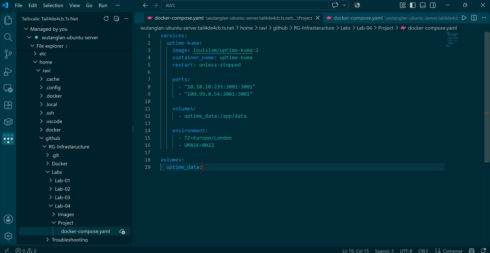
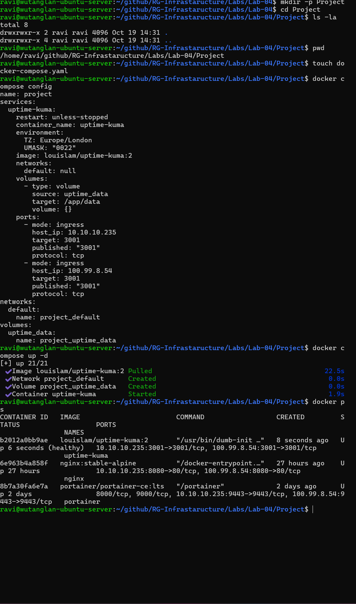
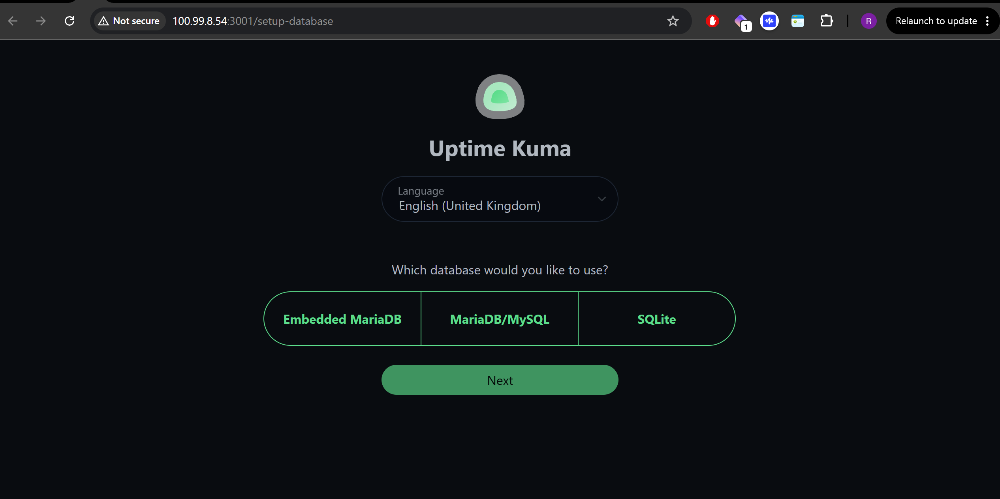
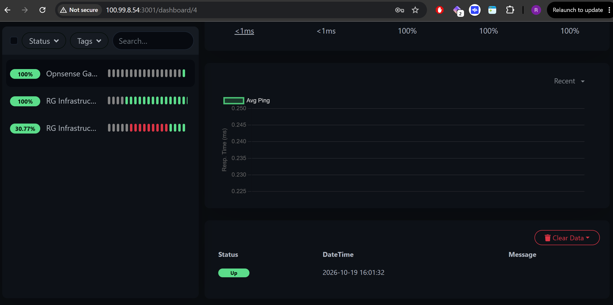
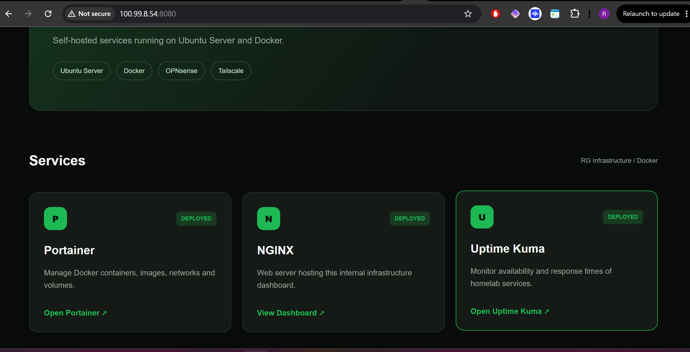

# Lab 04 — Deploying Uptime Kuma with Docker Compose

## Overview

In this lab, I deployed **Uptime Kuma**, an open-source monitoring application, on my HP ProDesk 400 G4 Mini running Ubuntu Server.

The objective was to introduce service monitoring into my RG Infrastructure homelab, allowing me to monitor the availability and response times of applications running in Docker.

This project also provided further hands-on experience with Docker Compose, persistent storage, networking and troubleshooting HTTPS certificate errors.

## Objectives

- Deploy Uptime Kuma using Docker Compose.
- Configure persistent storage using a Docker named volume.
- Access the application through my local network and Tailscale.
- Monitor my NGINX web server and Portainer.
- Troubleshoot a self-signed SSL certificate error.
- Identify my OPNsense gateway for additional monitoring.
- Update my internal RG Infrastructure dashboard.

## Infrastructure

| Component | Configuration |
|---|---|
| Host | HP ProDesk 400 G4 Mini |
| Operating System | Ubuntu Server |
| Container Platform | Docker Engine and Docker Compose |
| Application | Uptime Kuma v2 |
| LAN IP | `10.10.10.235` |
| Tailscale IP | `100.99.8.54` |
| Application Port | `3001` |
| Persistent Storage | Docker named volume |
| Default Gateway | `10.10.10.1` — OPNsense |

---

## 1. Creating the Project Directory

I created a dedicated directory within my RG Infrastructure GitHub repository to keep the Uptime Kuma configuration and documentation organised.

```bash
cd ~/github/RG-Infrastaructure/Labs

mkdir -p Lab-04/Project
mkdir -p Lab-04/Images

cd Lab-04/Project

touch docker-compose.yaml
```

The project structure is:

```text
Lab-04/
├── README.md
├── Images/
│   ├── 01-docker-copose-uptime-kuma.png
│   ├── 02-uptime-kuma-terminal.png
│   ├── 03-Uptime-Kuma-login-page.png
│   ├── uptime-kuma-dashboard.png
│   └── rg-infra-dashboard-updated.png
└── Project/
    └── docker-compose.yaml
```

## 2. Creating the Docker Compose Configuration

I used the official Uptime Kuma Docker image to create a Compose configuration.

The application was configured to listen on port `3001`, with access available through both my local network and Tailscale.

I also configured a named volume to persist application data.

### Docker Compose YAML

```yaml
services:
  uptime-kuma:
    image: louislam/uptime-kuma:2
    container_name: uptime-kuma
    restart: unless-stopped

    ports:
      - "10.10.10.235:3001:3001"
      - "100.99.8.54:3001:3001"

    volumes:
      - uptime_data:/app/data

    environment:
      - TZ=Europe/London
      - UMASK=0022

volumes:
  uptime_data:
```



### Configuration Explained

| Configuration | Purpose |
|---|---|
| `image` | Uses the Uptime Kuma v2 Docker image |
| `container_name` | Assigns a consistent name to the container |
| `restart` | Automatically restarts the container unless manually stopped |
| `ports` | Publishes port 3001 on the LAN and Tailscale interfaces |
| `volumes` | Provides persistent storage for monitoring data |
| `TZ` | Sets the timezone to Europe/London |
| `UMASK` | Configures the file creation permission mask |

### Persistent Storage

The following configuration creates a Docker named volume:

```yaml
volumes:
  - uptime_data:/app/data
```

The volume stores application data outside the container's writable layer.

This allows monitoring configuration and history to survive container recreation, provided the named volume is retained.

---

## 3. Validating the Docker Compose File

Before deploying the application, I validated the YAML configuration using:

```bash
docker compose config
```

The command completed successfully and displayed the resolved configuration.

Docker Compose identified the named volume as:

```text
project_uptime_data
```

The `project_` prefix comes from the Compose project name, which defaults to the directory name.

This demonstrated how Docker Compose automatically names and manages resources associated with a project.

## 4. Deploying Uptime Kuma

Once the YAML configuration was validated, I deployed the application using:

```bash
docker compose up -d
```

Docker successfully pulled the Uptime Kuma image and created the following resources:

| Resource | Name |
|---|---|
| Image | `louislam/uptime-kuma:2` |
| Container | `uptime-kuma` |
| Network | `project_default` |
| Volume | `project_uptime_data` |

I verified that the container was running using:

```bash
docker ps
```

The output confirmed that Uptime Kuma had started successfully alongside my existing NGINX and Portainer containers.



---

## 5. Accessing the Uptime Kuma Web Interface

Following deployment, I accessed the application through my Tailscale IP address:

```text
http://100.99.8.54:3001
```

The application was also accessible through my local network:

```text
http://10.10.10.235:3001
```

During the initial setup, I selected a database option and created an administrator account.

The persistent Docker volume provides storage for the application's database and configuration.



---

## 6. Configuring the NGINX Monitor

The first service I configured for monitoring was NGINX.

NGINX hosts my internal RG Infrastructure dashboard, which provides links to the services running in my homelab.

I created an HTTP monitor with the following configuration:

| Setting | Value |
|---|---|
| Monitor Type | HTTP(s) |
| Friendly Name | RG Infrastructure — NGINX |
| URL | `http://10.10.10.235:8080` |
| Heartbeat Interval | 60 seconds |

After saving the monitor, Uptime Kuma successfully connected to NGINX.

The monitoring dashboard reported:

```text
Status: UP
HTTP Response: 200 OK
```

This confirmed that the web server was responding successfully through its published Docker port.

## 7. Configuring the Portainer Monitor

The second service I added was Portainer.

Portainer provides a web interface for managing Docker containers, images, networks and volumes.

I configured the following HTTPS monitor:

| Setting | Value |
|---|---|
| Monitor Type | HTTP(s) |
| Friendly Name | RG Infrastructure — Portainer |
| URL | `https://10.10.10.235:9443` |
| Heartbeat Interval | 60 seconds |

### Troubleshooting — Incorrect Protocol

Initially, I attempted to monitor Portainer using HTTP instead of HTTPS.

Portainer uses HTTPS on port `9443`, so I corrected the monitor URL to:

```text
https://10.10.10.235:9443
```

However, Uptime Kuma continued to report Portainer as DOWN.

### Troubleshooting — Self-Signed Certificate

I inspected the monitoring event history and found the following error:

```text
self-signed certificate
```

Portainer uses a self-signed HTTPS certificate by default.

Although the application was accessible through my browser, Uptime Kuma rejected the certificate because it was not signed by a trusted certificate authority.

To resolve this in my internal homelab, I edited the Portainer monitor and enabled:

**Ignore TLS/SSL Error**

After saving the changes, Uptime Kuma successfully connected to Portainer.

The monitor reported:

```text
Status: UP
HTTP Response: 200 OK
```

This exercise demonstrated that a monitoring failure does not necessarily mean the application itself is unavailable.

In this case, the issue was related to TLS certificate validation rather than the Docker container or network connectivity.

Disabling certificate verification was a deliberate exception for this internal lab. A trusted certificate would be preferable in a production environment.

### Monitoring Dashboard

Both NGINX and Portainer were successfully monitored and reported UP.



---

## 8. Identifying the OPNsense Gateway

I also identified my OPNsense firewall as an additional monitoring target.

OPNsense provides routing and DHCP services for my `10.10.10.0/24` homelab network.

To identify the default gateway, I ran:

```bash
ip route
```

The output included:

```text
default via 10.10.10.1 dev enp2s0 proto dhcp src 10.10.10.235
```

This confirmed that the HP Mini uses `10.10.10.1` as its default gateway.

### Planned OPNsense Monitor

| Setting | Value |
|---|---|
| Monitor Type | Ping |
| Friendly Name | RG Infrastructure — OPNsense Gateway |
| Hostname | `10.10.10.1` |
| Heartbeat Interval | 60 seconds |

The Ping monitor will check whether the OPNsense gateway responds to ICMP requests.

This is useful for basic network availability monitoring, although it does not independently verify internet connectivity or the OPNsense web interface.

---

## 9. Updating the RG Infrastructure Dashboard

After successfully deploying Uptime Kuma, I updated my existing internal NGINX dashboard.

Previously, the Uptime Kuma service card was marked as:

```text
PLANNED
```

I updated it to:

```text
DEPLOYED
```

I also added a link to the Uptime Kuma web interface.

Because the NGINX website uses a bind mount, I was able to edit the HTML files directly on the host without rebuilding the Docker image.

This allowed the updated dashboard to appear immediately after refreshing the browser.



---

## 10. What I Learned

### Docker Compose

I gained further experience deploying applications through YAML configuration files rather than manually creating containers.

### Persistent Storage

I used a Docker named volume to ensure application data was stored independently of the container's writable layer.

### Container Networking

I configured access through both the local network and Tailscale using explicit host IP addresses and port mappings.

### HTTP and HTTPS Monitoring

I learned how Uptime Kuma checks application availability using HTTP requests and response status codes.

### TLS Certificate Validation

I encountered and resolved a monitoring failure caused by Portainer's self-signed certificate.

This reinforced the difference between application availability and successful TLS certificate validation.

### Linux Networking

I used `ip route` to identify the default gateway and understand how the HP Mini routes traffic through OPNsense.

---

## 11. Lab Outcome

Successfully deployed Uptime Kuma on my HP Mini using Docker Compose.

The deployment included:

- A running Uptime Kuma container.
- Persistent application storage using a named volume.
- Access through LAN and Tailscale.
- HTTP monitoring for NGINX.
- HTTPS monitoring for Portainer.
- Troubleshooting and resolution of a self-signed certificate error.
- An updated RG Infrastructure dashboard linking to Uptime Kuma.

Both configured application monitors successfully reported **UP**.

## Next Steps


- Deploy Prometheus and Grafana for additional infrastructure monitoring.

---

**Project:** RG Infrastructure  
**Lab:** 04 — Uptime Kuma  
**Technologies:** Ubuntu Server, Docker, Docker Compose, Uptime Kuma, NGINX, Portainer, OPNsense and Tailscale