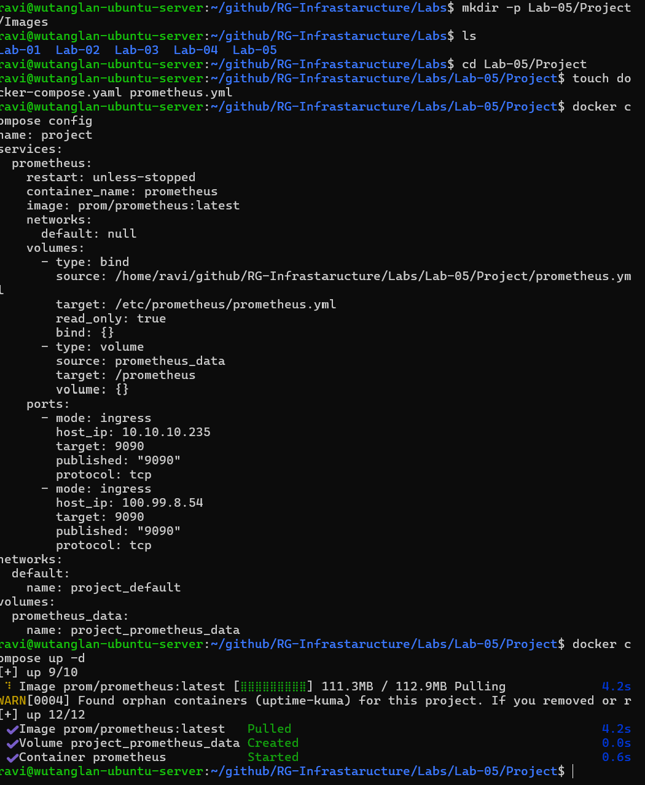
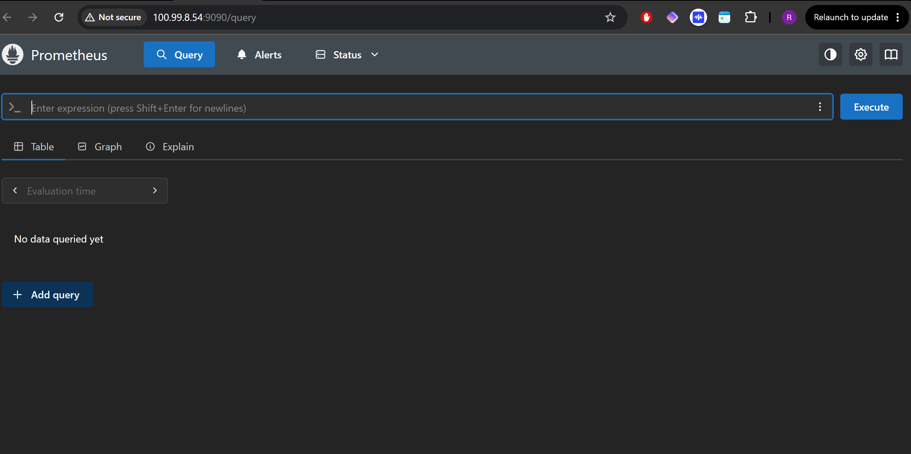
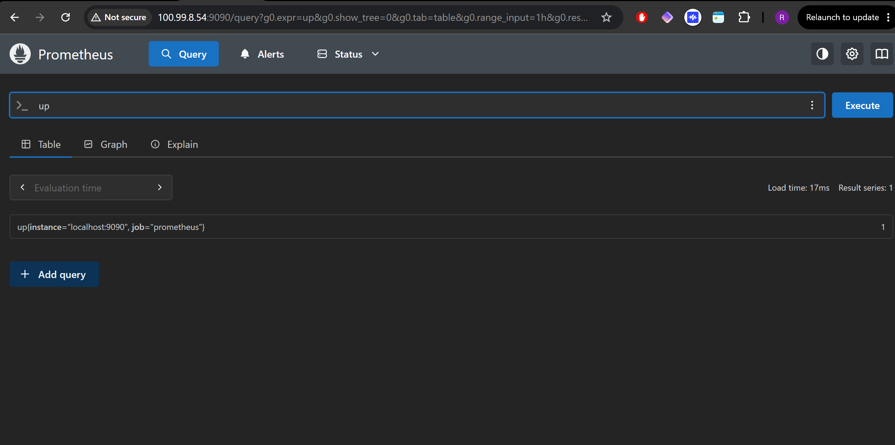
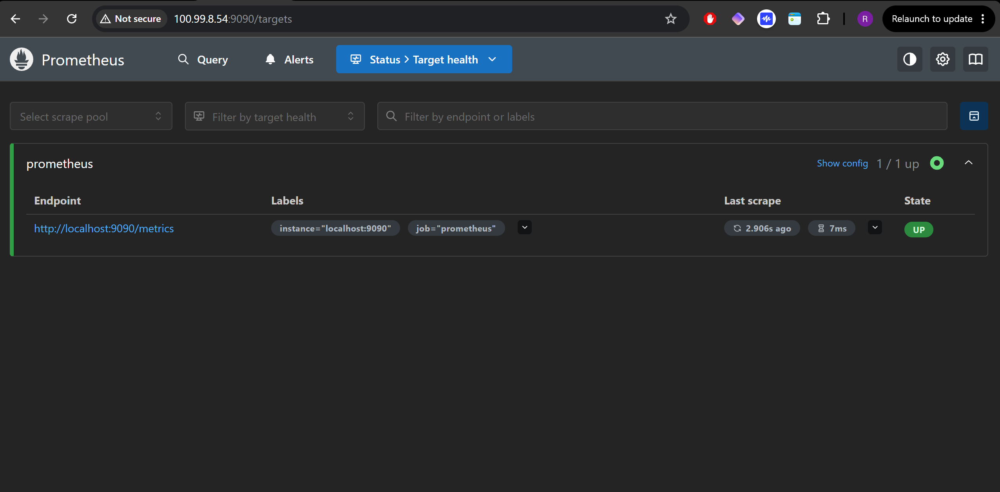
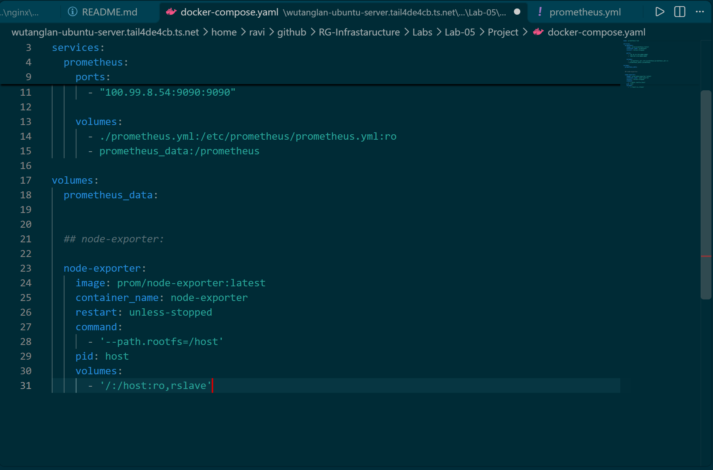
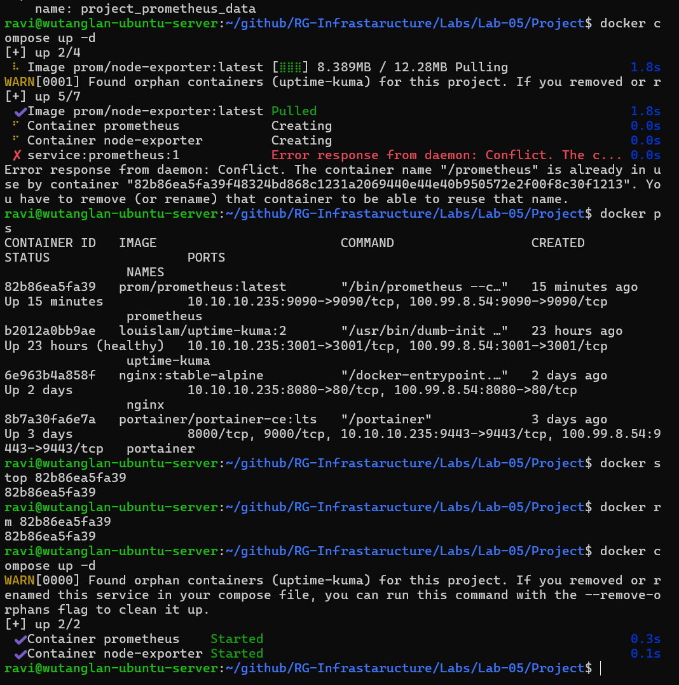
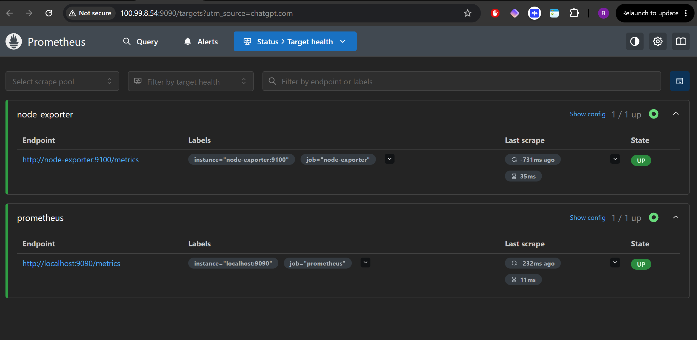
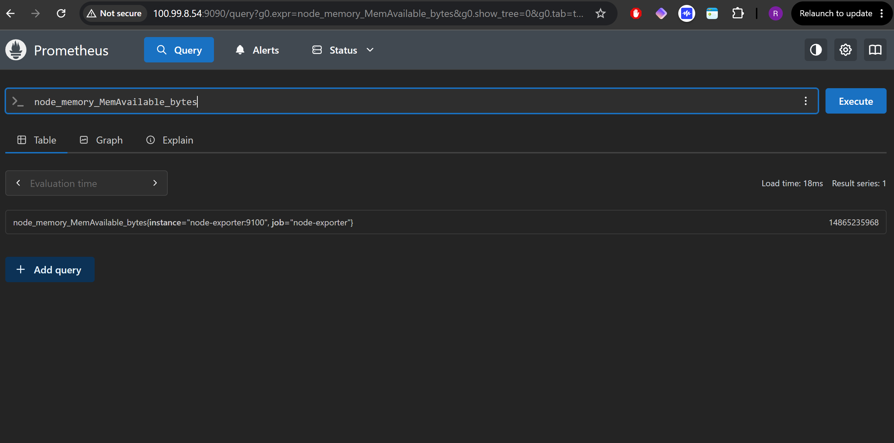

# Lab 05 — Prometheus & Node Exporter Monitoring

## Overview

In this lab, I deployed Prometheus and Node Exporter using Docker Compose on my HP ProDesk Ubuntu Server as part of my RG Infrastructure homelab project.

The objective was to introduce infrastructure monitoring and learn how to collect, query and analyse system metrics from a physical Linux server.

Prometheus collects and stores metrics, while Node Exporter exposes operating system metrics such as CPU, memory, disk and network activity.

Both services run in Docker containers and are managed using Docker Compose.

## Lab Objectives

- Deploy Prometheus using Docker Compose.
- Configure persistent storage for Prometheus.
- Access the Prometheus web interface over Tailscale.
- Understand Prometheus targets and scrape jobs.
- Deploy Node Exporter to collect host metrics.
- Configure Prometheus to scrape Node Exporter.
- Troubleshoot Docker Compose configuration and container conflicts.
- Query system metrics using PromQL.

## Environment

| Component | Configuration |
|---|---|
| Host | HP ProDesk 400 G4 Mini |
| Operating System | Ubuntu Server 24.04 LTS |
| Container Platform | Docker Engine |
| Orchestration | Docker Compose |
| Monitoring | Prometheus |
| Metrics Exporter | Node Exporter |
| LAN IP | 10.10.10.235 |
| Tailscale IP | 100.99.8.54 |
| Prometheus Port | 9090 |
| Node Exporter Port | 9100 (internal Docker network) |

## Architecture

```text
             HP ProDesk Mini
               Ubuntu Server
                    |
                 Docker
                    |
          Docker Compose Network
                    |
          +---------+---------+
          |                   |
    Node Exporter         Prometheus
       :9100                 :9090
          |                   |
          |---- Host Metrics ->|
                              |
                         PromQL Queries
                              |
                         Web Interface
                              |
                           Tailscale
                              |
                       Windows Browser
```

Node Exporter collects metrics from the Ubuntu host and exposes them on port 9100.

Prometheus connects to Node Exporter using Docker's internal service-name resolution and scrapes the metrics every 15 seconds.

I access the Prometheus web interface remotely using Tailscale.

---

## 1. Deploying Prometheus

I started by creating a Docker Compose configuration for Prometheus inside my Lab 05 project directory.

The configuration defines the Prometheus container, port mappings, persistent storage and a bind-mounted configuration file.

### Docker Compose Configuration

```yaml
name: prometheus-lab

services:
  prometheus:
    image: prom/prometheus:latest
    container_name: prometheus
    restart: unless-stopped
    ports:
      - "10.10.10.235:9090:9090"
      - "100.99.8.54:9090:9090"
    volumes:
      - ./prometheus.yml:/etc/prometheus/prometheus.yml:ro
      - prometheus_data:/prometheus

volumes:
  prometheus_data:
```

I validated the configuration before starting the container:

```bash
docker compose config
```

I then deployed Prometheus:

```bash
docker compose up -d
```

The container image was downloaded from Docker Hub, and Docker created the necessary network and persistent volume.

I verified the container using:

```bash
docker ps
```

### Screenshot — Prometheus Deployment



### What I Learned

- Docker Compose defines container configuration using YAML.
- Named volumes preserve application data when containers are recreated.
- Bind mounts allow containers to use configuration files stored on the host.
- Port mappings control which host interfaces expose a container's service.
- `restart: unless-stopped` allows Docker to restart the service automatically.

---

## 2. Accessing the Prometheus Dashboard

After starting the container, I accessed Prometheus using my HP Mini's Tailscale IP address.

**URL:**

```text
http://100.99.8.54:9090
```

This allows me to access the monitoring interface from another device connected to my Tailscale network.

### Screenshot — Prometheus Dashboard



## 3. Testing My First PromQL Query

Prometheus uses PromQL (Prometheus Query Language) to retrieve and analyse collected metrics.

I tested the following query:

```promql
up
```

The `up` metric indicates whether Prometheus can successfully scrape a configured target.

| Value | Meaning |
|---|---|
| 1 | Target is responding successfully |
| 0 | Target scrape failed |

Initially, Prometheus was configured to monitor itself.

The query returned:

```text
up{instance="localhost:9090", job="prometheus"} 1
```

This confirmed that Prometheus was collecting its own metrics.

### Screenshot — First PromQL Query



## 4. Checking Target Health

I navigated to the Prometheus target health page:

```text
http://100.99.8.54:9090/targets
```

Initially, only the Prometheus target was configured.

Its status showed **UP**, confirming successful metric collection.

### Screenshot — Initial Target Health



---

## 5. Deploying Node Exporter

The next objective was to collect system metrics from the HP Mini rather than monitoring only Prometheus itself.

For this, I deployed Node Exporter.

Node Exporter is a Prometheus exporter that exposes Linux operating system metrics, including:

- CPU utilisation
- Available and used memory
- Filesystem usage
- Disk activity
- Network statistics
- System uptime

I added a second service to my existing Docker Compose configuration.

### Updated Docker Compose Configuration

```yaml
name: prometheus-lab

services:
  prometheus:
    image: prom/prometheus:latest
    container_name: prometheus
    restart: unless-stopped
    ports:
      - "10.10.10.235:9090:9090"
      - "100.99.8.54:9090:9090"
    volumes:
      - ./prometheus.yml:/etc/prometheus/prometheus.yml:ro
      - prometheus_data:/prometheus

  node-exporter:
    image: prom/node-exporter:latest
    container_name: node-exporter
    restart: unless-stopped
    command:
      - '--path.rootfs=/host'
    pid: host
    volumes:
      - '/:/host:ro,rslave'

volumes:
  prometheus_data:
```

### Understanding the Node Exporter Configuration

**`image: prom/node-exporter:latest`**

Downloads the official Node Exporter container image.

**`command: '--path.rootfs=/host'`**

Tells Node Exporter where the host filesystem is mounted inside the container.

**`pid: host`**

Allows the container to use the host's PID namespace.

**`/:/host:ro,rslave`**

Mounts the host filesystem inside the container in read-only mode, using recursive slave mount propagation.

Node Exporter can then access host information needed to expose system metrics.

I did not publish port 9100 to the LAN or Tailscale interface because Prometheus can communicate with Node Exporter through the internal Docker Compose network.

### Screenshot — Updated Docker Compose Configuration



---

## 6. Troubleshooting Docker Compose

During the deployment, I encountered several issues.

### Issue 1 — YAML Configuration Error

After adding Node Exporter, I ran:

```bash
docker compose config
```

Docker returned an error similar to:

```text
volumes.prometheus_data additional properties 'node-exporter' not allowed
```

**Cause:**

I had placed the Node Exporter service under the top-level `volumes:` section instead of under `services:`.

YAML indentation is important because it determines the structure of the configuration.

**Resolution:**

I moved the Node Exporter definition into the `services:` section and left the named volume declaration at the bottom of the file.

I then validated the configuration again.

```bash
docker compose config
```

### Issue 2 — Container Name Conflict

When running:

```bash
docker compose up -d
```

Docker returned a container name conflict.

The error occurred because an existing container named `prometheus` had already been created by an earlier Compose deployment.

Docker container names must be unique.

I investigated the existing containers:

```bash
docker ps
```

For the conflicting container, I stopped it:

```bash
docker stop <container_id>
```

I then removed the stopped container:

```bash
docker rm <container_id>
```

After resolving the conflict, I ran:

```bash
docker compose up -d
```

Both Prometheus and Node Exporter started successfully.

**Lesson learned:** Removing and recreating a container can resolve a name conflict, but in future I should first inspect which Compose project owns it using `docker inspect` and avoid unnecessary disruption to existing services.

### Screenshot — Container Name Conflict



### Issue 3 — Orphan Container Warning

Docker Compose also displayed a warning about an orphaned `uptime-kuma` container.

This indicated that Docker Compose had detected a container associated with the Compose project but no longer defined in the current configuration.

I learned that Compose project names are important when managing multiple applications on the same Docker host.

To avoid conflicts between labs, I explicitly set the project name:

```yaml
name: prometheus-lab
```

This helps separate the Prometheus deployment from other Docker Compose projects.

I avoided using `--remove-orphans` because Uptime Kuma was an active service that I wanted to preserve.

### Screenshots — Orphan Container Troubleshooting


---

## 7. Configuring Prometheus to Scrape Node Exporter

Deploying Node Exporter alone does not automatically make its metrics available in Prometheus.

I needed to configure Prometheus to collect metrics from the Node Exporter endpoint.

I updated the existing `prometheus.yml` configuration file.

### Prometheus Configuration

```yaml
global:
  scrape_interval: 15s

scrape_configs:
  - job_name: "prometheus"
    static_configs:
      - targets: ["localhost:9090"]

  - job_name: "node-exporter"
    static_configs:
      - targets: ["node-exporter:9100"]
```

### Configuration Explained

**`scrape_interval: 15s`**

Prometheus collects metrics every 15 seconds.

**`job_name: "prometheus"`**

Defines a monitoring job for the Prometheus server itself.

**`localhost:9090`**

Refers to the Prometheus service running inside its own container.

**`job_name: "node-exporter"`**

Defines a separate monitoring job for the Linux host metrics.

**`node-exporter:9100`**

Uses the Node Exporter Docker Compose service name and its internal port.

Docker provides internal DNS resolution, allowing Prometheus to communicate with Node Exporter without publishing port 9100 externally.

After saving the configuration, I restarted Prometheus:

```bash
docker compose restart prometheus
```

---

## 8. Verifying Both Monitoring Targets

I returned to the Prometheus target health page:

```text
http://100.99.8.54:9090/targets
```

The configuration was successful when Prometheus reported both targets as **UP**.

| Job | Target | Expected Status |
|---|---|---|
| prometheus | localhost:9090 | UP |
| node-exporter | node-exporter:9100 | UP |

This confirmed that Prometheus could successfully collect metrics from Node Exporter.

### Screenshot — Monitoring Target Health



---

## 9. Querying Available System Memory

With Node Exporter configured, I tested a PromQL query to retrieve the HP Mini's available memory.

### PromQL Query

```promql
node_memory_MemAvailable_bytes
```

This metric reports the amount of memory currently available to applications without swapping, measured in bytes.

My query returned:

```text
14865235968
```

This represents approximately **13.84 GiB of available memory** at the time of the query.

To display the value directly in GiB, I can use:

```promql
node_memory_MemAvailable_bytes / 1024 / 1024 / 1024
```

### Screenshot — Available Memory Query



This confirmed that Prometheus was collecting actual operating system metrics from my physical Ubuntu Server.

---

## 10. Additional PromQL Queries

The following queries can be used for further monitoring and experimentation.

### Check Target Availability

```promql
up
```

### Available Memory in GiB

```promql
node_memory_MemAvailable_bytes / 1024 / 1024 / 1024
```

### Memory Utilisation Percentage

```promql
100 * (1 - node_memory_MemAvailable_bytes / node_memory_MemTotal_bytes)
```

### Average CPU Utilisation Percentage

```promql
100 * (1 - avg(rate(node_cpu_seconds_total{mode="idle"}[5m])))
```

### System Uptime in Hours

```promql
(time() - node_boot_time_seconds) / 3600
```

These queries provide a starting point for building dashboards and visualising infrastructure performance.

---

## 11. What I Learned

This lab introduced me to several important infrastructure monitoring concepts.

**Prometheus and Node Exporter**

I learned the difference between a monitoring system that collects metrics and an exporter that exposes metrics from a target system.

**Docker Networking**

I used Docker Compose service names to allow Prometheus to communicate with Node Exporter through the internal Docker network.

**YAML Configuration**

I experienced how incorrect YAML indentation can cause configuration validation errors.

**Container Lifecycle Management**

I practised identifying, stopping and removing conflicting containers, while also learning the importance of Compose project ownership.

**Persistent Storage**

I used a Docker named volume to preserve Prometheus monitoring data across container recreation.

**PromQL**

I queried live metrics from my physical Ubuntu Server and verified that Prometheus was successfully collecting available memory data.

**Troubleshooting**

I used terminal output, Docker commands and Prometheus target health checks to investigate and resolve deployment issues.

---

## 12. Lab Results

| Objective | Status |
|---|---|
| Deploy Prometheus | Complete |
| Configure persistent storage | Complete |
| Access Prometheus over Tailscale | Complete |
| Query Prometheus metrics | Complete |
| Deploy Node Exporter | Complete |
| Configure Node Exporter scrape job | Complete |
| Resolve Docker Compose YAML issues | Complete |
| Resolve container name conflicts | Complete |
| Investigate orphan container warnings | Complete |
| Verify Node Exporter memory metrics | Complete |

## Next Steps

The next stage of the RG Infrastructure monitoring project is to deploy Grafana.

Grafana will connect to Prometheus as a data source and provide dashboards for visualising CPU, memory, disk and network metrics.

The goal is to build a centralised monitoring dashboard for my HP Mini and eventually expand monitoring to additional homelab infrastructure.

---

## Project Files

```text
Lab-05/
├── README.md
├── Project/
│   ├── docker-compose.yaml
│   ├── prometheus.yml
│   └── Images/
│       ├── 01-prometheus-terminal.png
│       ├── 02-prometheus-dashboard.png
│       ├── 03-prometheus-query.png
│       ├── 04-prometheus-health.png
│       ├── 05-prometheus-and-node-exporter-docker-compose-yaml.png
│       ├── 06-node-exporter-docker-compose-troubleshooting.png
│       ├── 07-troubleshooting-found-orphan-1.png
│       ├── 07-troubleshooting-found-orphan-2.png
│       ├── 08-node-exporter-and-prometheus-health-check.png
│       └── 09-node-memory-memavailable_bytes.png
```

**Project:** RG Infrastructure

**Platform:** Ubuntu Server | Docker | Docker Compose | Prometheus | Node Exporter | Tailscale

**Lab Status:** Complete
